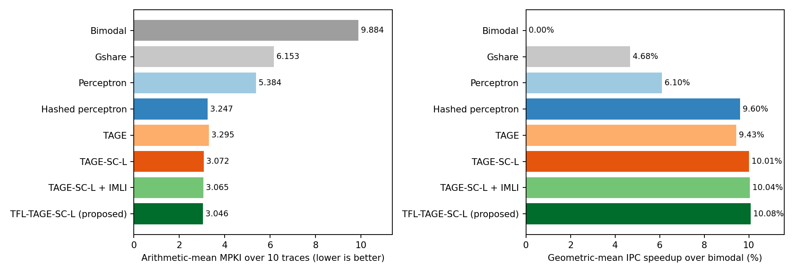
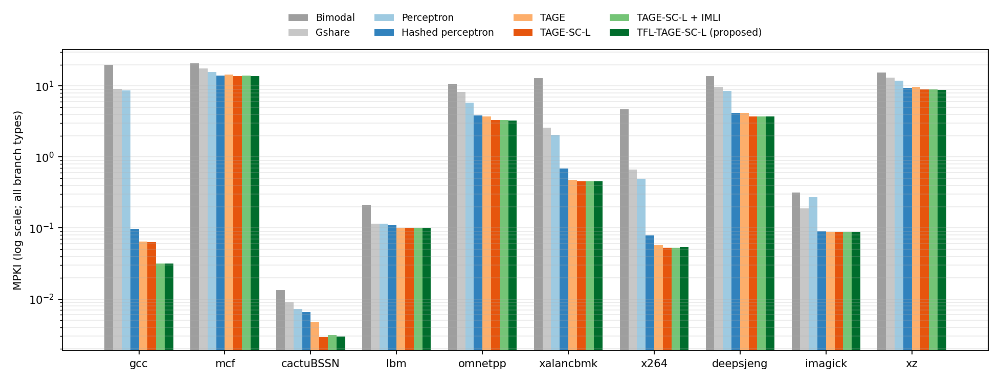
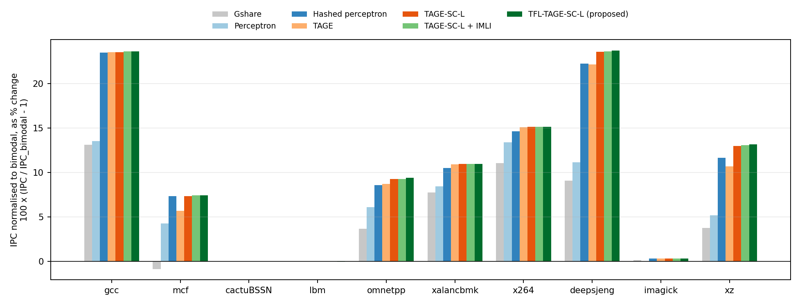
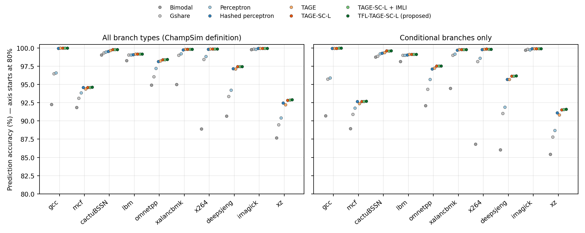
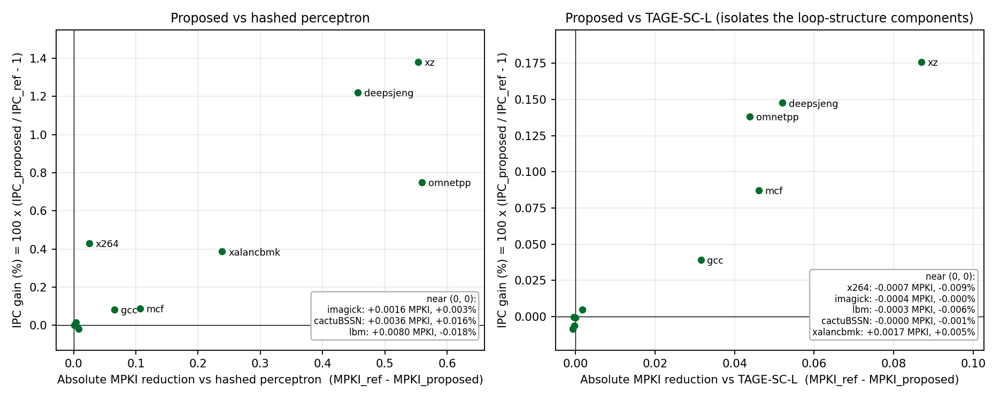
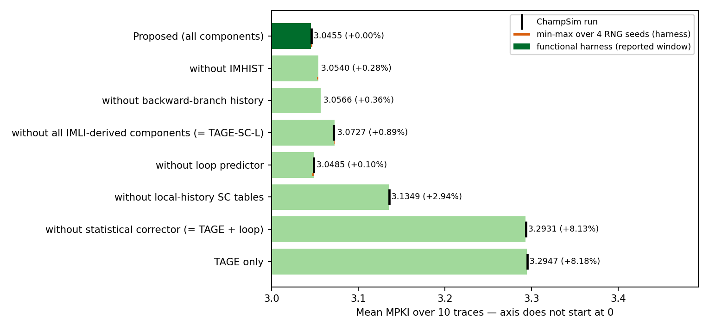
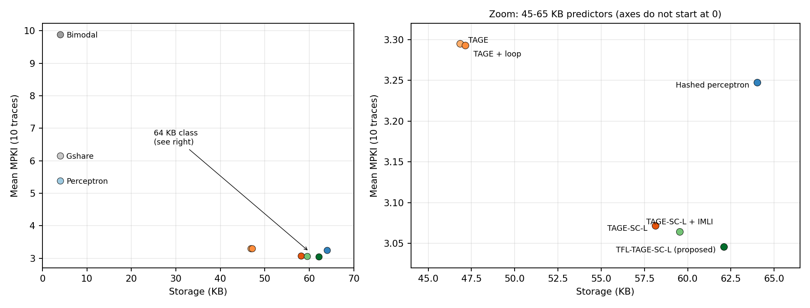

# TFL-TAGE-SC-L: A TAGE-SC-L Branch Predictor with Target-Free Loop-Structure History for ChampSim — Final Report (revised after audit)

## Abstract

This project designs, implements and evaluates a branch predictor for the 2021 version of ChampSim used in the course. In that version the predictor receives only the branch address and, after each prediction, its outcome; it is called for every branch type and is never told the branch type or target. Several established history features of TAGE-SC-L-style predictors — the Inner-Most-Loop-Iteration counter (IMLI), the per-IMLI-value outcome history (IMHIST) and a global history of backward branches — are defined on backward branches and therefore need the target. Our modification is a **target-free inference of backward branches**: because this ChampSim presents branches to the predictor strictly in program order without wrong-path execution, a taken branch jumped backward exactly when the next branch presented to the predictor has an address no larger than its own. We verify the inference against the simulator's own targets and use it to add IMLI-SIC, IMHIST and a backward-branch history to our re-implementation of TAGE-SC-L. The resulting predictor, TFL-TAGE-SC-L, uses 508,666 bits (62.09 KB) of logical state. On the ten required SPEC CPU2017 traces (50M warm-up + 200M measured instructions each, full ChampSim timing simulation) it reaches a mean MPKI of 3.046: 6.2% below the 64 KB hashed perceptron shipped with ChampSim (3.247) and 0.85% below our TAGE-SC-L without the loop-structure components (3.072). The corresponding geometric-mean IPC gains are much smaller: +0.43% over the hashed perceptron and +0.058% over TAGE-SC-L. The MPKI gain of each added component exceeds the run-to-run noise of the predictor; the IPC gain over TAGE-SC-L is small and is discussed with that caveat. TAGE, TAGE-SC-L, IMLI, IMHIST and backward-branch histories are published techniques; our contribution is the target-free inference that makes them usable in this interface, the integration, and the measured evaluation.

## 1. Problem statement and motivation

The assignment asks for a branch predictor in ChampSim that improves on suitable baselines, evaluated with IPC, branch prediction accuracy and MPKI. We use the ChampSim version supplied for the course (2021, `build_champsim.sh`). Its predictor interface, verified in `src/ooo_cpu.cc`, is:

```
uint8_t O3_CPU::predict_branch(uint64_t ip);
void    O3_CPU::last_branch_result(uint64_t ip, uint8_t taken);
```

- Both functions are called in `O3_CPU::read_from_trace()` for every instruction that the trace marks as a branch or that writes the instruction pointer, in trace order; `last_branch_result()` immediately follows `predict_branch()` with the true outcome.

- The predictor is never told the branch type; jumps, calls and returns are reported as taken. No target is passed.

- `read_from_trace()` is only called when the fetch buffer has room and stops when it is full, so no trace branch is skipped or reordered; there is no wrong-path fetch.

- A misprediction stalls fetch until the branch executes, plus `BRANCH_MISPREDICT_PENALTY` = 1 cycle.

Two observations motivated the work. First, among the predictors shipped with this ChampSim the hashed perceptron (64 KB) is by far the most accurate (mean MPKI 3.247), and a TAGE of similar storage is not better on average (3.295) because it loses on mcf and xz, the two traces that dominate mean MPKI. Combining TAGE with a perceptron-like statistical corrector (TAGE-SC-L) is the established remedy. Second, part of TAGE-SC-L's corrector accuracy comes from loop-structure history that needs to know which branches are backward — information this interface hides. The question we address is therefore: **can those loop-structure features be recovered inside the predictor, without changing the simulator, and what do they buy?**

## 2. Background and related work

Table 1. Related work used in this project (access level and claims checked in research/literature_review.md).

| Work | Core idea | Use in this project |
|---|---|---|
| Jiménez & Lin, HPCA 2001 [1] | Perceptron per branch over global history; train on mispredict or low confidence | Baseline; basis of the corrector's adder |
| Seznec & Michaud, JILP 2006 [7]; Seznec, MICRO 2011 [2] | TAGE: tagged tables, geometric history lengths, longest match provides | Base predictor (re-implemented) |
| Seznec, CBP-4 2014 / CBP-5 2016 [8] | TAGE-SC-L: TAGE + statistical corrector + loop predictor; 3.986 MPKI at 523,355 bits on CBP-5 traces | Architecture and update rules followed |
| Seznec, San Miguel, Albericio, MICRO 2015 [3] | IMLI counter; IMLI-SIC and IMLI-OH corrector components | IMLI-SIC used; IMHIST is the CBP-2016 successor of IMLI-OH |
| Jiménez, CBP-5 2016 [4] | Multiperspective perceptron: many feature types in one adder | Motivates heterogeneous corrector features |
| Michaud, TACO 2018 [5] | BATAGE; global controlled allocation throttling | Motivated an allocation-throttle experiment (rejected) |
| Lin & Tarsa, IISWC 2019 [6] | ~55% of mispredictions from ~10 hard-to-predict branches per slice (mcf 96.9%, xz 80.5%) | Explains the residual mispredictions on mcf/xz |
| ChampSim2 fork, PR #2, 2026 [11] | TAGE-SC-L adapter detects backward branches by comparing the next instruction's address (read from the simulator's input queue) with the PC | Closest related engineering; ours uses only predictor-visible information |

Newer work (CBP-2025 entries, LLBP [9], BranchNet, Whisper) needs much larger storage, offline training, ISA hints or data values the traces do not carry; it was reviewed but not used.

## 3. Baseline predictor designs

Table 2. Baselines, as implemented in this repository (storage = logical state from the source code; see Section 11.1).

| Predictor | Design (from the source) | Storage |
|---|---|---|
| Bimodal (repo) | 16,384 2-bit counters indexed by PC mod 16381 | 32,768 bits (4.0 KB) |
| Gshare (repo) | 16,384 2-bit counters indexed by hash(PC) XOR 14-bit global history | 32,782 bits (4.0 KB) |
| Perceptron (repo) [1] | 163 perceptrons x 25 8-bit weights, 24-bit history, theta = 60 | 32,624 bits (4.0 KB) |
| Hashed perceptron (repo) | 16 tables x 4,096 8-bit weights, history lengths 0-232, adaptive threshold | 524,542 bits (64.0 KB) |
| TAGE (ours) | Bimodal + 12 tagged tables (Section 4) | 383,674 bits (46.8 KB) |
| TAGE + loop (ours) | + 64-entry loop predictor | 386,177 bits (47.1 KB) |
| TAGE-SC-L (ours) | + statistical corrector (bias, global, path, local tables) | 476,319 bits (58.1 KB) |
| TAGE-SC-L + IMLI (ours) | + IMLI-SIC using the target-free inference | 487,658 bits (59.5 KB) |

The four repository predictors are unchanged. TAGE, TAGE + loop and TAGE-SC-L are configurations of the same implementation as the proposed design with components switched off at compile time, so the comparison isolates the components rather than implementation differences. The 4 KB predictors use one sixteenth of the storage; the like-for-like comparisons are against the hashed perceptron and our TAGE-SC-L.

## 4. Proposed architecture: TFL-TAGE-SC-L

TFL-TAGE-SC-L (TAGE-SC-L with Target-Free Loop-structure history) is implemented in `branch/tagescl.bpred` and selected by `branch/tfl_tage_scl.bpred` (`#define TSL_IMHIST`, `#define TSL_BHIST`).

### 4.1 Target-free backward-branch inference

Let B be a taken branch with target T and N the next branch presented to the predictor. Execution proceeds sequentially from T to N, so pc(N) ≥ T. If T ≤ pc(B), the sequential path from T reaches B itself, so pc(N) ≤ pc(B); if T > pc(B) then pc(N) ≥ T > pc(B). Hence:

```
B is backward  <=>  pc(next branch presented to the predictor) <= pc(B)      (taken instances)
```

The test runs at the start of the next `predict_branch()` call (`imli_on_next_branch()`), before any later prediction uses the loop state. Two 4,096-bit tables extend it: `bwd` remembers the inferred direction of each (hashed) branch for its not-taken, loop-exit instances, and `cond` marks a branch as conditional once it has been seen not-taken. Against ChampSim's own target (`branch_target = next_instr.ip`) the inference agreed on 99.9996–100% of taken branches on all ten traces (50M instructions each). The derived IMLI counter is an approximation: it matches a type- and target-aware counter closely where the counter carries information (clamped at 16: mcf 99.7%, x264 99.7%, gcc 96.4%, xz 95.7%, imagick 92.4%) and diverges on lbm, cactuBSSN and omnetpp, where backward conditional branches that almost never exit drive the oracle counter towards saturation.

### 4.2 Components and storage

Table 3. TFL-TAGE-SC-L structures; total equals the value printed by the predictor's storage_bits().

| Structure | Configuration | Bits |
|---|---|---|
| Bimodal base | 8K x 2-bit counters | 16,384 |
| Tagged tables T1–T12 | 2,048 entries each: 3-bit counter, 1-bit useful, 8–13-bit tag; histories 4, 6, 10, 16, 25, 40, 64, 101, 160, 254, 403, 640 | 366,592 |
| TAGE control | use_alt_on_na 4 x 5 bit, TICK, 640-bit global + 27-bit path history | 698 |
| Loop predictor | 64 entries (4-way): 2 x 10-bit trip counts, 10-bit tag, 4-bit confidence, 4-bit age, direction; WITHLOOP | 2,503 |
| SC bias tables | 3 x 1,024 x 6-bit (PC x TAGE prediction x confidence / provider table) | 18,432 |
| SC global + path GEHL | 4 global (lengths 6–40) + 3 path (9–25) tables x 1,024 x 6-bit | 43,008 |
| SC control | adaptive threshold, its counter, two chooser counters | 30 |
| SC local GEHL | 4 x 1,024 x 6-bit (lengths 3–16) + 256 x 16-bit local histories | 28,672 |
| IMLI-SIC | 512 x 6-bit table + 10-bit IMLI counter | 3,082 |
| Backward inference | bwd and cond tables (4,096 bits each) + previous branch PC and outcome | 8,257 |
| IMHIST | 256 x 10-bit histories (one per IMLI value) + 1,024 x 6-bit table | 8,704 |
| Backward-branch history | 16-bit history + 2 x 1,024 x 6-bit tables | 12,304 |
| **Total** |  | **508,666 (62.09 KB)** |

Not counted: the folded-history registers used for hashing (422 bits; recomputable from the global history) and the 64-bit pseudo-random generator state. Including them would not change any comparison in this report.

## 5. Prediction and training workflow

### 5.1 Prediction (Predictor::predict)

1. **Loop-structure state.** If the previous branch was taken, classify it as backward or forward from the current PC, store the bit in `bwd`, shift a 1 into the backward history if backward, and increment IMLI if the branch is backward and known to be conditional.

2. **TAGE lookup.** For each of the 12 tables compute an index (PC, folded global history, path history) and a tag. The longest matching table is the provider and the next longest the alternate (the bimodal table if none).

3. **TAGE prediction.** Use the provider's counter sign, except when the provider is newly allocated (weak counter) and the use_alt_on_na counter for its table group and the alternate's confidence says the alternate is more reliable. Confidence = provider counter magnitude (high, medium, low).

4. **Loop predictor.** If a 4-way loop entry matches the PC with full confidence and the global WITHLOOP counter is non-negative, its prediction (continue until the learned trip count, then exit) replaces TAGE's.

5. **Statistical corrector.** Sum the centred values (2c+1) of 6-bit counters from: 3 bias tables, 4 global-history, 3 path-history and 4 local-history GEHL tables, the IMLI-SIC table (weighted x2), the IMHIST table and the 2 backward-history tables.

6. **Final choice.** If the corrector's sign agrees, keep the prediction. Otherwise the corrector wins, except when TAGE is highly confident and |sum| < θ/4 (keep TAGE), or θ/4 ≤ |sum| < θ/2 (a chooser counter decides), or TAGE has medium confidence and |sum| < θ/4 (a second chooser decides).

### 5.2 Training (Predictor::update, called immediately with the true outcome)

1. **Corrector.** Train the two chooser counters in their zones; if the corrector was wrong or |sum| < θ, move every selected counter towards the outcome and adapt θ (it grows after repeated corrector mispredictions and shrinks after repeated low-confidence correct predictions).

2. **Loop predictor.** Update the matching entry's iteration count, trip count and confidence; free it if a confident prediction was wrong; on a TAGE misprediction, allocate an entry with probability 1/4.

3. **TAGE.** Update the provider counter, and also the alternate when a weak provider mispredicted. Clear the useful bit of weak providers; set it when the provider was right and the alternate wrong. On a TAGE misprediction allocate up to two entries in longer-history tables over useful = 0 entries with weak or medium counters (strong ones are decayed instead), skipping one table between allocations; if the final, corrected prediction was right, allocate only with probability 1/32. A TICK counter halves all useful bits when allocations keep failing.

4. **Histories.** Shift one bit ((PC ⊕ PC>>2) ⊕ taken) into the 640-bit global history and one PC bit into the 27-bit path history; update the branch's 16-bit local history.

5. **Loop-structure state.** A not-taken branch is marked conditional; if it is known to be backward it ends the inner loop: IMLI is reset and a 0 enters the backward history. The outcome of every branch known to be conditional is then appended to IMHIST[IMLI] (for a loop exit, this is IMHIST[0] because the reset happens first).

All branch types go through the same path. Unconditional branches are learnt as always-taken by the base table and add history bits like any other branch; the only type-dependent behaviour is the inferred `cond` bit that restricts IMLI counting and IMHIST to branches that have been seen not-taken. The predictor is deterministic (fixed-seed xorshift for the probabilistic decisions).

## 6. Implementation details

- `branch/tagescl.bpred` (C++11, one predictor object per CPU, only predictor-private state) implements all variants; compile-time switches (`TSL_NO_SC`, `TSL_NO_LOOP`, `TSL_NO_LOCAL`, `TSL_NO_IMLI`, `TSL_IMHIST`, `TSL_BHIST`, …) build the baselines and ablations from the same code.

- Wrappers `tfl_tage_scl.bpred`, `tage_scl.bpred` and `tage.bpred` select configurations for the standard `./build_champsim.sh <name> no no no no lru 1` workflow; each wrapper was checked to produce the same predictions as the corresponding compiler flags.

- The simulator core was changed only to print exact counters (`BP_STATS`, `BP_TYPE_MISSES`); the timing model is unchanged (a rebuilt bimodal reproduces an earlier course run's IPC and MPKI exactly).

- A functional replay harness (`experiments/harness`) drives the unmodified `.bpred` with the branch stream ChampSim would present, in seconds instead of hours. It was used for exploration, tuning and the ablation study, never for the headline results. Its mean MPKI matches ChampSim within 0.03% for every configuration; per trace it matches within 0.04% for the non-TAGE-SC-L predictors, but up to 0.82% for the TAGE-SC-L family on the two low-MPKI traces xalancbmk and imagick. The cause is a ChampSim detail: when a trace's first instruction is a branch, ChampSim presents it to the predictor twice (it initialises both its current and next instruction with the first record); this single extra call changes the random allocation history of TAGE-SC-L, which then evolves differently but with statistically equivalent accuracy.

## 7. Experimental methodology

### 7.1 Configuration and workloads

- ChampSim 2021, 1 core (6-wide fetch, 352-entry ROB), no prefetchers, LRU LLC.

- Ten SPEC CPU2017 SimPoint traces from DPC-3, each 2,000M instructions, all verified with `xz -t`.

- Every predictor and trace: 50M warm-up + 200M measured instructions (instructions 0–250M). The measured region retires 200,000,000–200,000,003 instructions (retirement is 4-wide).

- Design exploration and parameter tuning used the replay harness on a different window of the same traces (instructions 1000M–1150M; verified by re-extracting the stream). The two best candidates were then also compared on the reported window before the configuration was frozen (commit 660997e); the selected one was best on both windows, but the reported window was therefore not completely unseen.

Table 4. Workloads (measured window, bimodal run).

| Trace | Branches / 1,000 instr. | Conditional share | Hashed-perceptron MPKI | Proposed MPKI |
|---|---|---|---|---|
| 602.gcc_s-1850B | 256.4 | 83% | 0.097 | 0.032 |
| 605.mcf_s-1152B | 258.4 | 74% | 13.981 | 13.874 |
| 607.cactuBSSN_s-2421B | 1.4 | 52% | 0.007 | 0.003 |
| 619.lbm_s-2676B | 12.1 | 95% | 0.109 | 0.101 |
| 620.omnetpp_s-141B | 209.9 | 64% | 3.838 | 3.278 |
| 623.xalancbmk_s-10B | 258.7 | 90% | 0.692 | 0.453 |
| 625.x264_s-12B | 42.4 | 84% | 0.079 | 0.054 |
| 631.deepsjeng_s-928B | 147.1 | 66% | 4.166 | 3.709 |
| 638.imagick_s-824B | 161.3 | 64% | 0.090 | 0.089 |
| 657.xz_s-2302B | 125.0 | 85% | 9.417 | 8.863 |

### 7.2 Metrics

- **MPKI** = 1000 x mispredictions / retired instructions of the measured region (identical to ChampSim's printed MPKI to five decimals).

- **IPC** = measured instructions / measured cycles.

- **Accuracy** = (branches − mispredictions) / branches. ChampSim's definition counts **all branch types**; because unconditional branches are trivially predicted, we also report conditional-branch accuracy. The two are never mixed.

- **Aggregates**: arithmetic mean MPKI over the ten traces; percentage MPKI reductions computed from the means, (MPKI_ref − MPKI)/MPKI_ref x 100; IPC speedup as the geometric mean of per-trace IPC ratios, IPC improvement = (speedup − 1) x 100. Mean IPC is shown for information only.

### 7.3 Validity checks

All 110 ChampSim runs were re-parsed by an independent script: 1,258 checks (completion, exit status, window, no trace wrap-around, IPC and MPKI arithmetic, binary provenance, agreement with the original tables) with 0 failures. Every result was produced by the binary still present in `build/bin`, and every TAGE-family binary was built from the frozen predictor source. Baselines and proposed design were linked against the same simulator object files.

Run-to-run noise was measured by rebuilding the predictor with four different random seeds (harness, reported window): the standard deviation of mean MPKI is at most 0.028% of the mean. A ChampSim re-run of both designs with a different random seed gives +0.055% (seed changes alone move the geomean IPC of a design by +0.001% and +0.003%).

## 8. Overall performance comparison

Table 5. ChampSim results, 10 traces, 50M + 200M instructions (accuracy pooled over all branches of all traces).

| Predictor | KB | Mean MPKI | Int. MPKI (7) | Speedup vs bimodal | Speedup vs hashed perc. | Accuracy all | Accuracy cond. |
|---|---|---|---|---|---|---|---|
| Bimodal | 4.00 | 9.884 | 14.043 | 1.0000 | 0.9124 | 93.289% | 91.243% |
| Gshare | 4.00 | 6.153 | 8.745 | 1.0468 | 0.9551 | 95.822% | 94.766% |
| Perceptron | 3.98 | 5.384 | 7.634 | 1.0610 | 0.9681 | 96.345% | 95.301% |
| Hashed perceptron | 64.03 | 3.247 | 4.610 | 1.0960 | 1.0000 | 97.795% | 97.113% |
| TAGE | 46.84 | 3.295 | 4.680 | 1.0943 | 0.9984 | 97.763% | 97.074% |
| TAGE + loop | 47.14 | 3.293 | 4.677 | 1.0943 | 0.9984 | 97.764% | 97.075% |
| TAGE-SC-L | 58.14 | 3.072 | 4.361 | 1.1001 | 1.0037 | 97.914% | 97.269% |
| TAGE-SC-L + IMLI | 59.53 | 3.065 | 4.350 | 1.1004 | 1.0040 | 97.919% | 97.276% |
| **TFL-TAGE-SC-L (proposed)** | 62.09 | 3.046 | 4.323 | 1.1008 | 1.0043 | 97.932% | 97.292% |

Table 6. Proposed predictor relative to each baseline (MPKI reductions from the means; IPC improvement from the geometric-mean speedup).

| Baseline | Baseline MPKI | Abs. MPKI reduction | % MPKI reduction | IPC improvement | Traces: lower / higher MPKI | Traces: higher / lower IPC |
|---|---|---|---|---|---|---|
| Bimodal | 9.8843 | 6.8387 | 69.19% | +10.078% | 10 / 0 | 9 / 1 |
| Hashed perceptron | 3.2475 | 0.2018 | 6.22% | +0.433% | 10 / 0 | 9 / 1 |
| TAGE | 3.2953 | 0.2497 | 7.58% | +0.590% | 9 / 1 | 9 / 1 |
| TAGE-SC-L | 3.0717 | 0.0260 | 0.85% | +0.058% | 6 / 4 | 6 / 4 |
| TAGE-SC-L + IMLI | 3.0646 | 0.0190 | 0.62% | +0.031% | 6 / 4 | 7 / 3 |



Figure 1 and Tables 5–6 show three tiers. The 4 KB predictors reduce MPKI from bimodal's 9.88 to 5.38–6.15. The 45–64 KB predictors reach 3.0–3.3 MPKI. Within that tier, TAGE alone is slightly worse than the hashed perceptron (3.295 vs 3.247); adding the statistical corrector gives the largest single step (3.293 → 3.072); the loop-structure components add a further 0.85% (3.072 → 3.046). IPC follows the same order but compresses the differences: the whole 45–64 KB tier lies between 9.43% and 10.08% over bimodal.

## 9. Per-benchmark analysis



Figure 2 shows that mean MPKI is dominated by mcf and xz (and then omnetpp and deepsjeng); cactuBSSN, lbm and imagick are near zero for every advanced predictor. Against the hashed perceptron the proposed predictor has lower MPKI on all ten traces; against TAGE-SC-L it is lower on 6 traces (gcc, mcf, omnetpp, xalancbmk, deepsjeng, xz) and marginally higher on the four near-zero traces, by at most 0.0007 MPKI.



Figure 3 shows the IPC consequence. gcc and deepsjeng gain more than 20% over bimodal with any advanced predictor, mcf, omnetpp, xalancbmk and xz gain 5–15%, and the FP traces do not change because they have almost no mispredictions to remove.



Figure 4 compares the two accuracy definitions. Unconditional branches are always predicted correctly once seen, so all-branch accuracy is higher than conditional accuracy (pooled, proposed: 97.932% vs 97.292%); the ranking of predictors is the same under both. Accuracy differences of a fraction of a percent hide large MPKI differences on branch-dense traces, which is why MPKI is the primary metric.



Figure 5 relates MPKI reduction and IPC gain per trace. The relationship is not proportional: the IPC gain is approximately ΔMPKI x (cycles saved per avoided misprediction) / (1000 x CPI). Table 7 decomposes the measured gain over the hashed perceptron (Table 7); the cycles saved per avoided misprediction are themselves measured (Δcycles/Δmispredictions), so the table explains rather than predicts.

Table 7. Decomposition of the IPC gain over the hashed perceptron.

| Trace | ΔMPKI | Cycles saved per avoided misprediction | CPI (hashed perc.) | Measured IPC gain |
|---|---|---|---|---|
| gcc | 0.065 | 36.9 | 2.88 | +0.084% |
| mcf | 0.107 | 26.7 | 3.20 | +0.089% |
| cactuBSSN | 0.004 | n/a | 0.84 | +0.016% |
| lbm | 0.008 | n/a | 1.58 | -0.018% |
| omnetpp | 0.560 | 39.2 | 2.95 | +0.749% |
| xalancbmk | 0.239 | 50.2 | 3.11 | +0.387% |
| x264 | 0.025 | 95.9 | 0.56 | +0.431% |
| deepsjeng | 0.457 | 22.4 | 0.85 | +1.221% |
| imagick | 0.002 | n/a | 0.82 | +0.003% |
| xz | 0.553 | 25.0 | 1.02 | +1.381% |

mcf removes 0.107 mispredictions per 1,000 instructions at ~27 cycles each, but spends ~3.2 cycles per instruction (mostly memory stalls), so its IPC gain is below 0.1%; xz removes 0.55 per 1,000 at ~25 cycles with a CPI near 1, giving +1.4%. x264 saves ~96 cycles per avoided misprediction but has very few to remove. The near-zero traces move by thousandths of a percent in either direction — timing noise of the out-of-order model. Against TAGE-SC-L (right panel) the same pattern holds at one tenth of the scale: the largest gains are xz, deepsjeng and omnetpp (+0.14% to +0.18%).

## 10. Ablation study

The ablation removes one component (or one group) at a time from the proposed design, keeping everything else identical. It was run with the functional replay harness on both windows; six of the configurations were also simulated in ChampSim, and five were re-run with four random seeds to measure noise.

Table 8. Ablation (harness unless stated). Δ = change in mean MPKI relative to the full design.

| Configuration | Harness MPKI (reported window) | Δ reported window | Δ tuning window | Δ range over 4 seeds | ChampSim MPKI (Δ) |
|---|---|---|---|---|---|
| Proposed (all components) | 3.0455 | +0.00% | +0.00% |  | 3.0456 (+0.00%) |
| without IMHIST | 3.0540 | +0.28% | +0.30% | +0.17% … +0.28% | not run |
| without backward-branch history | 3.0566 | +0.36% | +0.37% | +0.32% … +0.36% | not run |
| without all IMLI-derived components (= TAGE-SC-L) | 3.0727 | +0.89% | +0.95% | +0.84% … +0.89% | 3.0717 (+0.86%) |
| without loop predictor | 3.0485 | +0.10% | +0.09% | +0.01% … +0.10% | 3.0485 (+0.09%) |
| without local-history SC tables | 3.1349 | +2.94% | +2.84% | — | 3.1359 (+2.96%) |
| without statistical corrector (= TAGE + loop) | 3.2931 | +8.13% | +8.10% | — | 3.2933 (+8.13%) |
| TAGE only | 3.2947 | +8.18% | +8.18% | — | 3.2953 (+8.20%) |



Figure 6 and Table 8 support the following conclusions. The **statistical corrector** is by far the most important component (+8.1% MPKI without it), and within it the **local-history tables** contribute most (+2.9%). The three loop-structure components together are worth +0.9% on both windows and in ChampSim; individually the backward-branch history (+0.3%) and IMHIST (+0.2–0.3%) give consistent gains well above the seed noise (≤ 0.03% standard deviation). The **loop predictor**'s contribution (+0.01% to +0.10% across seeds, +0.09% in ChampSim) is of the same size as the noise and is therefore inconclusive — consistent with the IMLI paper's observation that IMLI-SIC captures most loops the loop predictor would. The harness and ChampSim agree on every cross-checked configuration within 0.0010 mean MPKI and in the sign of every change.

### 10.1 Exploration and negative results (harness, tuning window)

Table 9. Design alternatives explored and rejected (functional harness, tuning window, mean MPKI change).

| Experiment | Δ mean MPKI | Decision |
|---|---|---|
| Per-branch TAGE allocation throttle in TAGE-SC-L (3 settings) | −0.00% / +0.06% / +0.09% | rejected |
| Same throttle in plain TAGE | −0.49% / −0.55% | works in TAGE; subsumed in TAGE-SC-L by its 1/32 allocation rule |
| IMLI counting every taken backward branch (no conditional filter) | +0.14% | rejected |
| Region-based IMLI (256-byte regions) | +0.16% | rejected |
| IMLI hashed into two global corrector tables | +0.19% alone, +0.20% with IMHIST + BHIST | rejected |
| 2 history bits per branch; longest history 1000 / 2000 | +0.28%; +0.15% / +0.96% | rejected |

## 11. Design Trade-offs and Motivation

**Why might TFL-TAGE-SC-L be preferable to the baselines, and what does it cost?**

### 11.1 Accuracy versus storage

Table 10. Storage, accuracy and IPC, with the increment over the previous design in the chain.

| Predictor | Storage (bits) | Mean MPKI | Speedup vs bimodal | Compared with | Δ storage | Δ MPKI | Δ IPC |
|---|---|---|---|---|---|---|---|
| Bimodal | 32,768 | 9.8843 | 1.0000 | — | — | — | — |
| Gshare | 32,782 | 6.1527 | 1.0468 | Bimodal | +14 | -3.7316 (-37.75%) | +4.678% |
| Perceptron | 32,624 | 5.3835 | 1.0610 | Bimodal | -144 | -4.5008 (-45.53%) | +6.105% |
| Hashed perceptron | 524,542 | 3.2475 | 1.0960 | Bimodal | +491,774 | -6.6369 (-67.15%) | +9.604% |
| TAGE | 383,674 | 3.2953 | 1.0943 | Hashed perceptron | -140,868 | +0.0478 (+1.47%) | -0.156% |
| TAGE + loop | 386,177 | 3.2933 | 1.0943 | TAGE | +2,503 | -0.0020 (-0.06%) | -0.002% |
| TAGE-SC-L | 476,319 | 3.0717 | 1.1001 | TAGE + loop | +90,142 | -0.2216 (-6.73%) | +0.534% |
| TAGE-SC-L + IMLI | 487,658 | 3.0646 | 1.1004 | TAGE-SC-L | +11,339 | -0.0070 (-0.23%) | +0.027% |
| TFL-TAGE-SC-L (proposed) | 508,666 | 3.0456 | 1.1008 | TAGE-SC-L + IMLI | +21,008 | -0.0190 (-0.62%) | +0.031% |



Figure 7 shows the accuracy–storage frontier. Going from 4 KB to the 45–64 KB class buys most of the improvement (about 3x lower MPKI). Inside that class the proposed design is the most accurate predictor evaluated and uses 15,876 fewer bits than the hashed perceptron (62.09 vs 64.03 KB; this holds even if the 422 folded-history bits and 64 random-generator bits are counted). Relative to TAGE-SC-L it costs 32,347 more bits (3.95 KB, +6.8%) for a 0.85% MPKI reduction. The most storage-efficient step is the statistical corrector (+90,142 bits for −6.7%); the loop-structure components are less efficient per bit but still reduce MPKI.

### 11.2 MPKI reduction versus IPC improvement

Lower MPKI does not translate proportionally into IPC (Section 9). Against the hashed perceptron, a 6.2% MPKI reduction gives +0.43% IPC; against TAGE-SC-L, 0.85% gives +0.058%. Three reasons: (i) the traces where the components help most (mcf, omnetpp) are memory-bound, so a saved misprediction is a small fraction of execution time; (ii) in this ChampSim an avoided misprediction saves roughly 22–50 cycles on most traces (the fetch stall until the branch executes); (iii) on four traces MPKI is already near zero. A ChampSim re-run of both designs with a different random seed gives +0.055% (seed changes alone move the geomean IPC of a design by +0.001% and +0.003%). The IPC gain over TAGE-SC-L is therefore reproducible — about 15 times larger than the seed-induced variation and of the same sign on every trace where it is not negligible — but it is small (about 0.06%) and concentrated on xz, deepsjeng, omnetpp and mcf; the MPKI reduction is the main result.

### 11.3 Components versus incremental benefit, and history versus complexity

- **Statistical corrector** (+90,142 bits over TAGE + loop): -6.7% MPKI. Clearly justified.

- **Local-history SC tables** (28,672 bits): removing them raises MPKI by 3.0% and lowers IPC by 0.22% in ChampSim. Justified.

- **IMLI-SIC + inference tables** (+11,339 bits): −0.23% MPKI on top of TAGE-SC-L.

- **IMHIST + backward history** (+21,008 bits): a further −0.62% MPKI.

- **Loop predictor** (2.5 Kbit): no measurable benefit once IMLI is present; it could be removed to save storage and an override path.

- Complexity added by the contribution is small in logic terms: one PC comparison per branch, two bit tables, a 10-bit counter, a 16-bit history and four extra corrector tables summed by the existing adder tree.

### 11.4 Variation across benchmarks

Gains concentrate on branch-dense integer traces with loop structure (xz, deepsjeng, omnetpp, mcf, gcc). FP traces gain nothing because they have almost no mispredictions left; mcf and xz retain most of their mispredictions with every predictor because they are dominated by data-dependent branches (Lin & Tarsa attribute 96.9% and 80.5% of their mispredictions to a few hard-to-predict branches [6]).

### 11.5 Hardware latency, area and power

These were **not measured**: ChampSim models neither predictor access latency, area nor energy, and storage in bits is not silicon area. Qualitatively, the proposed design reads 13 TAGE tables, a loop table and 18 corrector tables per prediction (vs. 16 tables for the hashed perceptron); TAGE-SC-L designs are normally pipelined over two cycles with an overriding scheme, and the extra corrector inputs lengthen the adder tree by about one level. A real implementation would also need speculative management and repair of the loop-structure state, which this immediate-update simulator does not model.

### 11.6 Is the trade-off worth it?

Relative to the predictors shipped with ChampSim, yes: TFL-TAGE-SC-L is the most accurate design evaluated (6.2% lower MPKI than the hashed perceptron, lower on every trace) at slightly less storage, with a +0.43% geometric-mean IPC gain. Relative to TAGE-SC-L, the added 3.9 KB buys a robust but small 0.85% MPKI reduction and an IPC gain that is too small to be a decisive argument on its own. The modification is worth adopting where the interface hides branch targets and storage is available; if storage is the binding constraint, TAGE-SC-L without the loop-structure components is the better accuracy-per-bit choice.

## 12. Limitations and threats to validity

- **Workloads.** Ten SimPoint windows of ten programs; tuning used other windows of the same programs, and the final choice between two near-identical candidates also looked at the reported window. Gains of under 1% are small relative to trace-to-trace variation.

- **Simulator.** Direction prediction only, immediate update, no wrong path, no BTB; all branch types count in accuracy and MPKI. Absolute numbers are not comparable with newer ChampSim versions or CBP results.

- **Inference.** Exact only because this ChampSim presents every branch in order without wrong-path fetch; a speculative front end would need checkpointing and repair. IMLI depends on recognising conditional branches by their first not-taken outcome.

- **Re-implementation.** Our TAGE-SC-L (12 tables, ~58 KB) is not Seznec's championship code (36 logical tables). No claim is made relative to published state-of-the-art predictors, which were evaluated on different traces, simulators and budgets.

- **Statistics.** One deterministic ChampSim run per configuration; noise was measured with alternative seeds in the harness and, for IPC, with one alternative seed in ChampSim.

- **Storage** is a logical bit count; the hashed perceptron's threshold width (8 bits) is an assumption.

## 13. Conclusion and future work

We re-implemented TAGE-SC-L for the 2021 ChampSim interface and showed that the backward-branch information it needs can be recovered exactly from the order in which branches reach the predictor. This makes IMLI-SIC, IMHIST and a backward-branch history usable without simulator changes. The resulting TFL-TAGE-SC-L reaches 3.046 mean MPKI — 6.2% below the hashed perceptron and 0.85% below TAGE-SC-L — with geometric-mean IPC gains of +0.43% and +0.058%. The MPKI gains of the added components are robust to run-to-run noise; their IPC impact is small because the traces that benefit are memory-bound. Future work: evaluate on the remaining SPEC CPU2017 traces and other suites; remove the loop predictor and re-tune the storage; model speculative history repair and predictor latency; and port the inference to the newer ChampSim interface, where the target is available, to measure what the inference loses relative to exact targets.

## 14. References

[1] D. A. Jiménez, C. Lin, “Dynamic Branch Prediction with Perceptrons,” HPCA 2001.

[2] A. Seznec, “A New Case for the TAGE Branch Predictor,” MICRO 2011.

[3] A. Seznec, J. San Miguel, J. Albericio, “The Inner Most Loop Iteration Counter: A New Dimension in Branch History,” MICRO 2015.

[4] D. A. Jiménez, “Multiperspective Perceptron Predictor,” CBP-5, 2016.

[5] P. Michaud, “An Alternative TAGE-like Conditional Branch Predictor,” ACM TACO 15(3), 2018.

[6] C.-K. Lin, S. J. Tarsa, “Branch Prediction Is Not a Solved Problem: Measurements, Opportunities, and Future Directions,” IISWC 2019 (arXiv:1906.08170).

[7] A. Seznec, P. Michaud, “A case for (partially) TAgged GEometric history length branch prediction,” JILP 8, 2006.

[8] A. Seznec, “TAGE-SC-L Branch Predictors,” CBP-4, 2014; “TAGE-SC-L Branch Predictors Again,” CBP-5, 2016.

[9] F. Schall et al., “The Last-Level Branch Predictor,” MICRO 2024.

[10] N. Gober et al., “The Championship Simulator: Architectural Simulation for Education and Competition,” arXiv:2210.14324, 2022.

[11] R. Bera, ChampSim2, pull request #2 “Merging many development features to mainline,” GitHub, 2026 (CBP-6 TAGE-SC-L adapter).