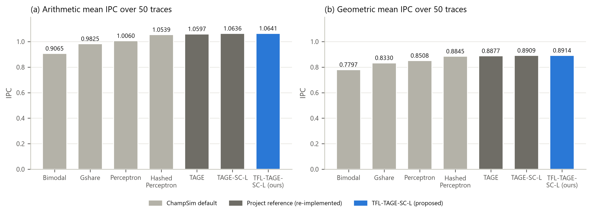
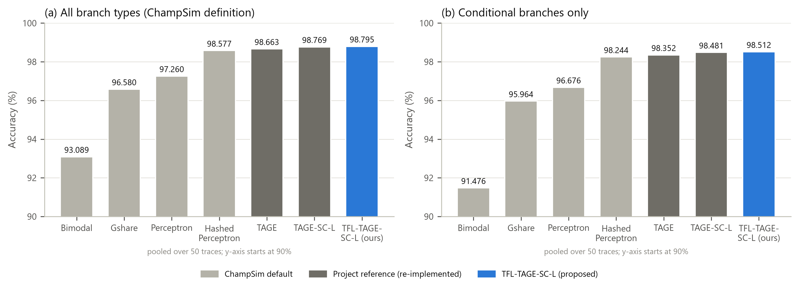
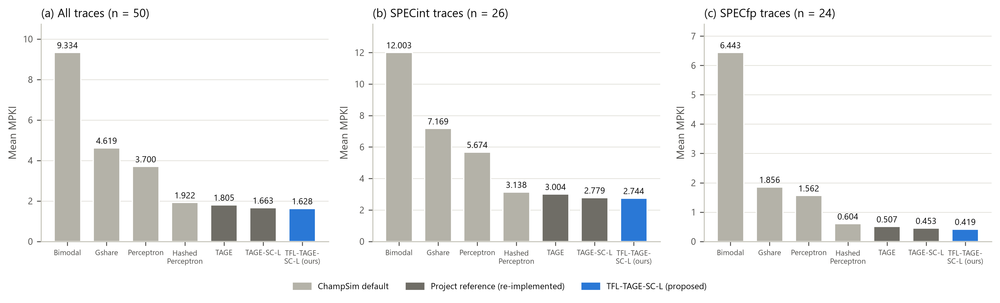
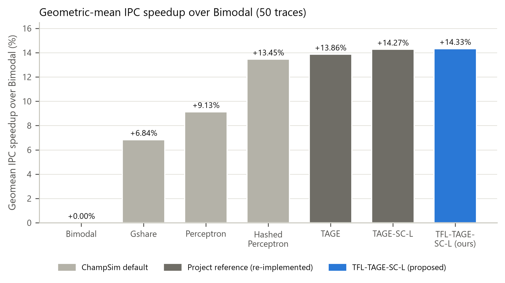
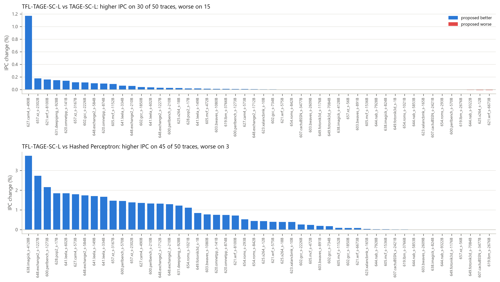
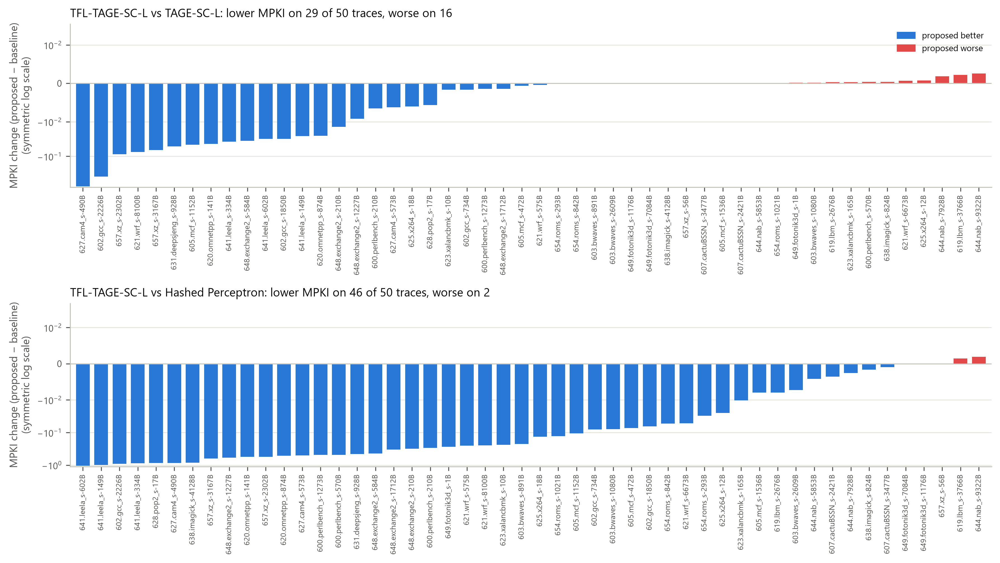
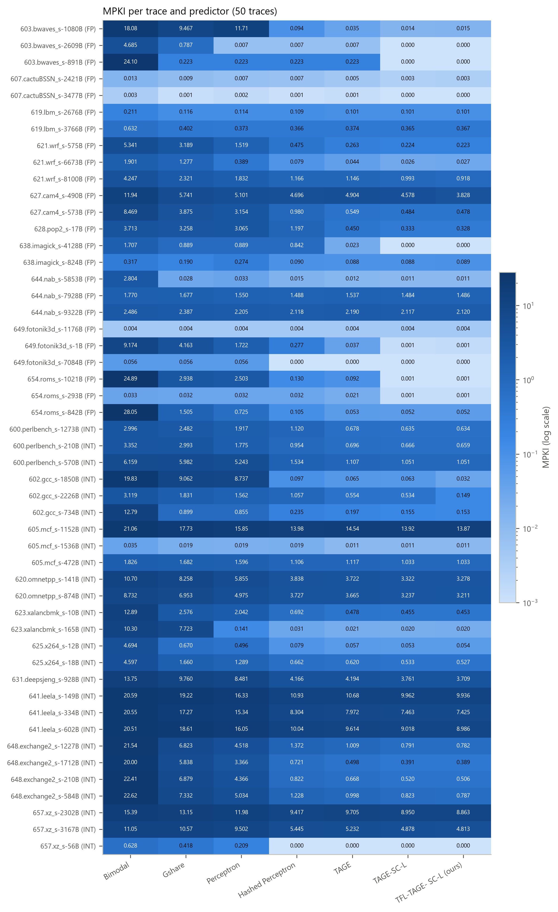
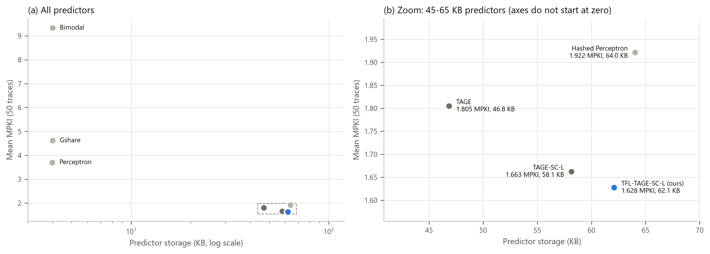
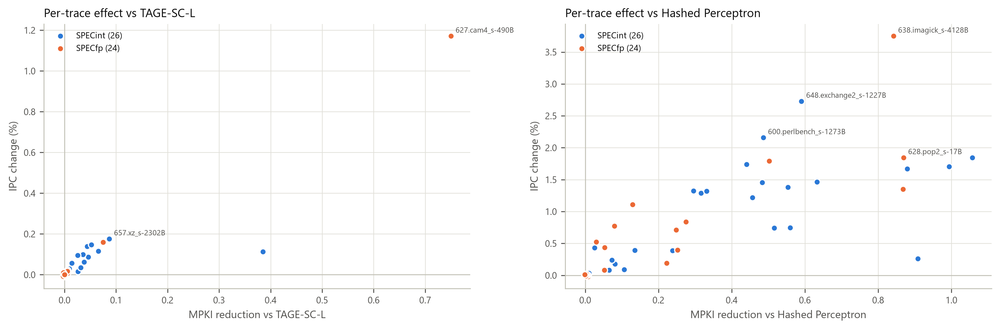
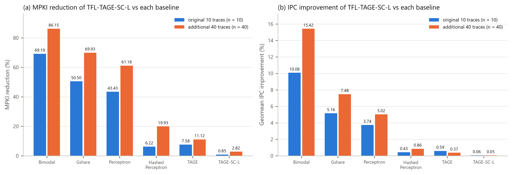

# TFL-TAGE-SC-L — results and comparison (50-trace evaluation)

Generated from the CSVs in this folder by `experiments/scripts/make_report_50trace.py`. 350 of 350 runs successful; aggregates over 50 traces (10 original + 40 additional SPEC CPU2017 traces), 50M warm-up + 200M measured instructions each, ChampSim 2021 (1 core, no prefetchers, LRU LLC). The full analysis is in `report_50trace/TFL-TAGE-SC-L_50trace_Report.pdf`.

## Overall

| Predictor | Storage (KB) | Mean IPC | Geomean IPC | Speedup vs Bimodal | Mean MPKI | Accuracy all | Accuracy cond. |
|---|---:|---:|---:|---:|---:|---:|---:|
| Bimodal | 4.00 | 0.9065 | 0.7797 | +0.00% | 9.334 | 93.089% | 91.476% |
| Gshare | 4.00 | 0.9825 | 0.8330 | +6.84% | 4.619 | 96.580% | 95.964% |
| Perceptron | 3.98 | 1.0060 | 0.8508 | +9.13% | 3.700 | 97.260% | 96.676% |
| Hashed perceptron | 64.03 | 1.0539 | 0.8845 | +13.45% | 1.922 | 98.577% | 98.244% |
| TAGE | 46.84 | 1.0597 | 0.8877 | +13.86% | 1.805 | 98.663% | 98.352% |
| TAGE-SC-L | 58.14 | 1.0636 | 0.8909 | +14.27% | 1.663 | 98.769% | 98.481% |
| TFL-TAGE-SC-L (proposed) | 62.09 | 1.0641 | 0.8914 | +14.33% | 1.628 | 98.795% | 98.512% |

Mean IPC = arithmetic mean of per-trace IPC; geomean IPC = geometric mean; speedup = geometric mean of per-trace IPC ratios; MPKI = arithmetic mean over traces (all branch types); accuracy pooled over all branches.

## TFL-TAGE-SC-L relative to each baseline

| Baseline | Baseline MPKI | MPKI reduction | Geomean IPC improvement | Traces lower/equal/higher MPKI | Traces higher/equal/lower IPC | Largest IPC gain | Largest IPC loss |
|---|---:|---:|---:|---|---|---|---|
| Bimodal | 9.334 | 82.56% | +14.329% | 49/1/0 | 47/1/2 | 654.roms_s-842B (+72.76%) | 619.lbm_s-2676B (-0.01%) |
| Gshare | 4.619 | 64.76% | +7.013% | 49/1/0 | 48/1/1 | 623.xalancbmk_s-165B (+27.51%) | 619.lbm_s-2676B (-0.01%) |
| Perceptron | 3.700 | 56.01% | +4.767% | 49/1/0 | 48/1/1 | 603.bwaves_s-1080B (+18.97%) | 619.lbm_s-2676B (-0.01%) |
| Hashed perceptron | 1.922 | 15.29% | +0.772% | 46/2/2 | 45/2/3 | 638.imagick_s-4128B (+3.75%) | 619.lbm_s-2676B (-0.02%) |
| TAGE | 1.805 | 9.82% | +0.413% | 46/3/1 | 46/3/1 | 657.xz_s-2302B (+2.23%) | 619.lbm_s-2676B (-0.02%) |
| TAGE-SC-L | 1.663 | 2.09% | +0.052% | 29/5/16 | 30/5/15 | 627.cam4_s-490B (+1.17%) | 621.wrf_s-6673B (-0.01%) |

## Trace subsets

| Subset | n | Mean MPKI HP | Mean MPKI TAGE-SC-L | Mean MPKI proposed | MPKI red. vs HP | MPKI red. vs TAGE-SC-L | IPC vs TAGE-SC-L |
|---|---:|---:|---:|---:|---:|---:|---:|
| All traces | 50 | 1.922 | 1.663 | 1.628 | 15.29% | 2.09% | +0.052% |
| Original 10 | 10 | 3.247 | 3.072 | 3.046 | 6.22% | 0.85% | +0.058% |
| Additional 40 | 40 | 1.590 | 1.310 | 1.273 | 19.93% | 2.82% | +0.051% |
| SPECint | 26 | 3.138 | 2.779 | 2.744 | 12.56% | 1.26% | +0.049% |
| SPECfp | 24 | 0.604 | 0.453 | 0.419 | 30.68% | 7.61% | +0.056% |

## Figures

## Files

| File | Contents |
|---|---|
| `raw_results.csv` | one row per predictor x trace run (350), with status, counters, metrics, log path |
| `per_trace_results.csv` | one row per trace: IPC / MPKI / accuracy of all predictors, deltas of the proposed predictor |
| `summary.csv` | one row per predictor: aggregates, storage, runtime |
| `subset_summary.csv` | aggregates on trace subsets |
| `comparison_vs_baselines.csv` | proposed vs each baseline |
| `trace_manifest.csv` | the 50 traces, sizes, checksums |
| `experiment_config.json` | exact settings, metric definitions, build information |
| `run_status.csv`, `failure_report.md` | status of every run |
| `checks.txt`, `report_verification.txt` | consistency checks of the results and of the report |
| `TFL-TAGE-SC-L_50trace_Results.xlsx` | all of the above as a workbook, with the figures |
